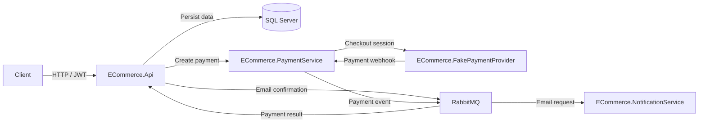

# 🛒 ECommerce Backend

**A multi-vendor marketplace backend built with .NET 10.**

A layered REST API, RabbitMQ-backed messaging, and dedicated payment and email services run together with `docker compose up -d --build`.

> **Work in progress:** this is a portfolio project for local development and learning, not a production storefront.

---

## 📑 Contents

- [Project Overview](#project-overview)
- [Key Features](#key-features)
- [Architecture](#architecture)
- [Technology Stack](#technology-stack)
- [Engineering Highlights](#engineering-highlights)
- [Project Structure](#project-structure)
- [Getting Started](#getting-started)
- [Service Endpoints](#service-endpoints)
- [End-to-End Walkthrough](#end-to-end-walkthrough)
- [Email and Payment Simulation](#email-and-payment-simulation)
- [Operational and Reliability Considerations](#operational-and-reliability-considerations)
- [Roadmap / Planned Enhancements](#roadmap)

---

<a id="project-overview"></a>

## 🌐 Project Overview

This repository implements the backend of a **multi-vendor marketplace**. Customers browse a catalog contributed by independent sellers, fill one cart, and check out once; the system splits that checkout into **per-seller sub-orders**. Payment is handled by a separate service that talks to a bundled provider simulator and reports results back to the main API asynchronously.

> **Intended order flow:** create an order → complete payment → reconcile the successful payment with the order → let sellers confirm and begin processing their portions. The current implementation does not yet enforce every transition in this sequence; see [Roadmap / Planned Enhancements](#roadmap).

The system runs as **four .NET processes** plus four infrastructure containers:

| Process | Kind | Role |
|---|---|---|
| `ECommerce.Api` | ASP.NET Core Web API | Identity, catalog, sellers, cart, orders, payment orchestration |
| `ECommerce.PaymentService` | ASP.NET Core Web API | Payment records, provider integration, signed-webhook endpoint |
| `ECommerce.FakePaymentProvider` | ASP.NET Core (API + Razor Pages) | Simulated payment provider with a hosted checkout page |
| `ECommerce.NotificationService` | .NET Worker Service | Consumes email requests and delivers them over SMTP |

SQL Server, RabbitMQ, Seq and Mailpit complete the Compose stack.

**The engineering problems this codebase is built around:**

- **Consistency across service boundaries without distributed transactions.** State changes and the events that describe them are committed together (transactional outbox), and consumers apply events idempotently (inbox / processed-message tables).
- **At-least-once messaging that tolerates failure.** Publisher confirms, manual acknowledgements, TTL-based retry queues, dead-letter queues, and reconnect loops. The system is designed for at-least-once delivery with idempotent handlers; it does not claim exactly-once processing.
- **Concurrency on shared state.** Stock and cart mutations are expressed as conditional, set-based SQL statements whose affected-row counts decide the outcome, backed by unique indexes where races would otherwise create duplicates.
- **Security boundaries.** JWT with server-side revocation, role and ownership checks on protected resources, and HMAC-verified webhooks.

---

<a id="key-features"></a>

## ✨ Key Features

### Identity and authentication

- Registration creates the user, assigns the `Customer` role, creates the user's cart, and writes an email-confirmation outbox record — **in one database transaction**.
- Email confirmation is required before sign-in (`RequireConfirmedEmail`); a resend endpoint is available.
- Account lockout after 5 failed attempts for 15 minutes (ASP.NET Core Identity lockout).
- JWT access tokens (HS256, 15 minutes by default) with issuer, audience and lifetime validation and zero clock skew.
- **Server-side token revocation** through a `token_version` claim that is checked against the database on every authenticated request.

### Authorization and roles

- Roles `Customer`, `Seller`, `Admin` are seeded by EF Core seeding during migration.
- `Customer` is assigned at registration. `Seller` is granted **self-service** by creating a seller profile (the response carries a fresh token). `Admin` is created by a development-only seeder from environment configuration.
- Authorization combines `[Authorize(Roles = ...)]` with ownership predicates inside queries (orders by user, products and seller orders by seller profile).

### Product catalog and categories

- Public product listing and detail endpoints show only products that are active, not blocked, and owned by a seller who is not banned.
- Sellers create, update, activate and deactivate their own products; admins block and unblock any product. A blocked product cannot be re-activated by its seller.
- Stock status is derived (`OutOfStock` at 0, `LowStock` at 5 or fewer, otherwise `InStock`).
- Categories are admin-managed, unique by normalized name, and cannot be deleted while they contain products.

### Seller management

- Create, view, update and delete a seller profile; public seller listing.
- Deleting a profile deactivates and detaches its products, removes the `Seller` role, and rotates the token version.
- Admins can list seller profiles, **ban** and **unban** sellers (role removal plus token revocation take effect immediately), and delete profiles.

### Shopping cart

- One cart per user, created at registration.
- Add, increment, decrement and remove items. Quantity changes are atomic and bounded by current stock.
- The cart view reports per-item availability (`Available`, `Unavailable`, `OutOfStock`, `InsufficientStock`) and totals only the available lines.

### Orders and checkout

- Checkout turns the whole cart into one `Order` containing one `SellerOrder` per seller, with product name and unit price **snapshotted** into order items.
- Stock is **reserved at checkout**. Cancellation and seller rejection include stock-restoration logic; their interaction with paid orders remains under development.
- Sellers can list, confirm or reject their own seller orders. The intended rule is that confirmation follows successful payment, but the current endpoints do not yet enforce it.
- Customers list and view their own orders; admins have read access to all orders.

### Payment processing

- `POST /api/orders/{id}/pay` asks PaymentService for a payment and returns a provider checkout URL.
- PaymentService reuses an existing pending payment for the same order, refuses duplicates, and applies provider results through a signed, idempotent webhook.
- Payment outcomes travel back to the API as `payment.succeeded` / `payment.failed` events and are recorded on the order (`PaymentId`, `PaidAtUtc`).

### Email notifications

- Email-confirmation messages are delivered by NotificationService with deduplication, delayed retries and a dead-letter queue. Local delivery goes to Mailpit; an external SMTP server can be configured.

### Administration

- Category management, seller ban/unban/delete, product block/unblock, and read access to all orders.

---

<a id="architecture"></a>

## 🏗️ Architecture



The client calls the main REST API. Its application and domain layers handle requests, while infrastructure persists data to SQL Server, which hosts separate databases for the services. The API starts payments through PaymentService, which integrates with the simulated provider. RabbitMQ carries email requests to NotificationService and payment results back to the API. The API layers are part of one process, not separate services.

---

<a id="technology-stack"></a>

## 🛠️ Technology Stack

| Category | Technologies |
|---|---|
| **Runtime and framework** | .NET 10 (`net10.0`), ASP.NET Core controllers, Worker Service host (NotificationService), Razor Pages (provider checkout page), AutoMapper 16 |
| **Database and ORM** | SQL Server 2022 (Developer edition container), Entity Framework Core 10 with the SQL Server provider, code-first migrations, set-based `ExecuteUpdate` / `ExecuteDelete` |
| **Security and identity** | ASP.NET Core Identity (EF stores), JWT Bearer authentication (HS256), role-based authorization, HMAC-SHA256 webhook signatures |
| **Messaging** | RabbitMQ 4 (management image), `RabbitMQ.Client` 7.2, publisher confirms, quorum queues, dead-letter exchanges, TTL retry queues |
| **Background processing** | `BackgroundService` workers: outbox processors (API, PaymentService), payment-result consumer (API), email consumer (NotificationService) |
| **Payments** | Dedicated PaymentService plus a simulated provider (`FakePaymentProvider`) |
| **Email** | MailKit 4.18 (SMTP, STARTTLS or plain), Mailpit for local capture |
| **Observability** | Serilog (`Serilog.AspNetCore`, console and Seq sinks) in the API with request logging; default console logging in the other services |
| **Containerization** | Docker multi-stage builds (`sdk:10.0` → `aspnet:10.0` / `runtime:10.0`), Docker Compose with health-gated startup |
| **API documentation** | `Microsoft.AspNetCore.OpenApi` and Swashbuckle Swagger UI in the API and PaymentService (Development environment) |
| **Testing and automation** | GitHub Actions restores and builds in Release on pushes and pull requests to `master`; automated unit and integration testing is planned |

---

<a id="engineering-highlights"></a>

## ⚙️ Engineering Highlights

- **Layered Architecture.** The API handles HTTP requests, Application coordinates use cases, Domain defines the business model, and Infrastructure supplies persistence and integrations. This keeps responsibilities clear as the project grows.
- **Transactional Outbox.** The API and PaymentService store integration events in the same transaction as the related database changes, then publish them asynchronously. This reduces the risk of losing an event after a successful commit.
- **RabbitMQ Messaging.** Email requests and payment results move between services asynchronously. Consumers use acknowledgements, retries for transient failures, and dead-letter queues for messages that cannot be processed.
- **Idempotent Processing.** PaymentService reuses pending payments and handles repeated provider webhooks safely; consumers track processed messages to limit duplicate effects from redelivery.
- **Payment Integration.** A separate PaymentService owns payment records and works with FakePaymentProvider's browser checkout sessions and signed webhooks. The simulator lets checkout and payment callbacks be exercised locally.
- **Security & Authorization.** ASP.NET Core Identity and JWT protect user sessions, while role checks, ownership predicates, and token revocation restrict access to protected resources.
- **Containerized Environment.** Docker Compose starts the four .NET processes and their SQL Server, RabbitMQ, Seq, and Mailpit dependencies, making local setup repeatable.

---

<a id="project-structure"></a>

## 🗂️ Project Structure

```text
ecommerce-backend-api/
├── compose.yml                          # 8-service local stack
├── .env.example                         # required variables (copy to .env)
├── .github/workflows/main.yml           # CI: restore + build
├── ECommerce.Api.slnx
│
├── ECommerce.Api/                       # HTTP host (ASP.NET Core)
│   ├── Controllers/                     #   Auth, Carts, Categories, Products, Orders/, SellerProfiles/
│   ├── Program.cs                       #   DI, Identity, JWT, Serilog, migrations, hosted services
│   └── Dockerfile
├── ECommerce.Application/               # use cases (library)
│   ├── Services/                        #   Auth, Cart, Category, Product, SellerProfile, Order, OrderPayment
│   ├── Interfaces/                      #   service + repository + unit-of-work + outbox abstractions
│   ├── DTOs/  Mapping/  Results/        #   request/response models, AutoMapper profiles, Result/Error
│   └── Authorization/  Authentication/  #   role names, custom claim types
├── ECommerce.Domain/                    # entities + enums (library)
├── ECommerce.Contracts/                 # message contracts + routing keys (library)
├── ECommerce.Infrastructure/            # implementations (library)
│   ├── Persistence/                     #   DbContext, configurations, repositories, outbox/inbox, seeding
│   ├── Identity/  Authentication/       #   IdentityService, ApplicationUser, JWT generation
│   ├── Messaging/                       #   RabbitMQ publisher, payment-result consumer + topology
│   └── Migrations/                      #   ECommerceDb migrations
│
├── ECommerce.PaymentService/            # payments API + webhook + outbox (own DB, own migrations)
├── ECommerce.FakePaymentProvider/       # simulated provider: sessions, Razor checkout page, webhook sender
└── ECommerce.NotificationService/       # email consumer worker (own DB, own migrations)
```

| Project | Depends on | Responsibility |
|---|---|---|
| `ECommerce.Api` | Application, Infrastructure | Composition root and HTTP layer: routing, authentication, error mapping, background hosting |
| `ECommerce.Application` | Domain, Contracts | Business workflows; defines the abstractions that Infrastructure implements |
| `ECommerce.Infrastructure` | Application, Domain | EF Core, Identity, JWT, RabbitMQ, outbox/inbox, migrations |
| `ECommerce.Domain` | — | Entities and enums |
| `ECommerce.Contracts` | — | Event records and routing keys shared across processes |
| `ECommerce.PaymentService` | Contracts | Independent service with its own data store |
| `ECommerce.NotificationService` | Contracts | Independent worker with its own data store |
| `ECommerce.FakePaymentProvider` | — | Self-contained simulator |

---

<a id="getting-started"></a>

## 🚀 Getting Started

### 1. Prerequisites

- **Git**
- **Docker** with **Docker Compose v2** (Docker Desktop, or Docker Engine with the Compose plugin). SQL Server for Linux needs at least 2 GB of memory available to Docker.
- Free local ports `8080`, `8081`, `8082`, `8025`, `15672`, `5341` (all configurable in `.env`)
- Optional, only for building outside Docker: the .NET 10 SDK

### 2. Clone

```bash
git clone https://github.com/NazarPishchuk/ecommerce-backend-api.git
cd ecommerce-backend-api
```

### 3. Configure the environment

`compose.yml` refuses to start unless these variables are set, and `.env.example` contains all of them:

| Variable | Purpose |
|---|---|
| `SQLSERVER_SA_PASSWORD` | SQL Server `sa` password — must satisfy SQL Server complexity rules |
| `RABBITMQ_PASSWORD` | Password for the `ecommerce` RabbitMQ user |
| `SEQ_ADMIN_PASSWORD` | First-run password for the Seq `admin` user |
| `JWT_KEY` | HS256 signing key, at least 32 characters |
| `SEED_ADMIN_EMAIL` / `SEED_ADMIN_PASSWORD` | Development admin account (password must satisfy Identity's default policy) |
| `PAYMENT_WEBHOOK_SECRET` | Shared HMAC secret between PaymentService and the provider |

Optional variables with defaults: `JWT_ISSUER`, `JWT_AUDIENCE`, `API_PORT`, `PAYMENT_PORT`, `FAKE_PAYMENT_PORT`, `MAILPIT_UI_PORT`, `RABBITMQ_UI_PORT`, `SEQ_UI_PORT`, `PUBLIC_API_URL`, `PUBLIC_FAKE_PAYMENT_URL`, and the `SMTP_*` group (see [Email and Payment Simulation](#email-and-payment-simulation)).

Create your local `.env` from the template:

```bash
cp .env.example .env              # macOS / Linux
```
```powershell
Copy-Item .env.example .env       # Windows PowerShell
```

### 4. Generate local development secrets

Generate a fresh value for each of the six `CHANGE_ME_*` entries and paste it into `.env`. The `Aa1!` prefix guarantees that the two passwords with complexity rules (SQL Server, Identity) are accepted; the rest is random hex, which is safe inside the connection strings Compose builds.

**macOS / Linux** (requires `openssl`):

```bash
gen() { openssl rand -hex "$1"; }

printf 'SQLSERVER_SA_PASSWORD=Aa1!%s\n' "$(gen 16)"
printf 'RABBITMQ_PASSWORD=%s\n'         "$(gen 16)"
printf 'SEQ_ADMIN_PASSWORD=%s\n'        "$(gen 16)"
printf 'JWT_KEY=%s\n'                   "$(gen 32)"
printf 'SEED_ADMIN_PASSWORD=Aa1!%s\n'   "$(gen 16)"
printf 'PAYMENT_WEBHOOK_SECRET=%s\n'    "$(gen 32)"
```

**Windows PowerShell** (5.1 and 7+):

```powershell
function New-Secret([int]$Bytes) {
    $buffer = New-Object byte[] $Bytes
    $rng = [System.Security.Cryptography.RandomNumberGenerator]::Create()
    $rng.GetBytes($buffer)
    $rng.Dispose()
    -join ($buffer | ForEach-Object { $_.ToString('x2') })
}

"SQLSERVER_SA_PASSWORD=Aa1!$(New-Secret 16)"
"RABBITMQ_PASSWORD=$(New-Secret 16)"
"SEQ_ADMIN_PASSWORD=$(New-Secret 16)"
"JWT_KEY=$(New-Secret 32)"
"SEED_ADMIN_PASSWORD=Aa1!$(New-Secret 16)"
"PAYMENT_WEBHOOK_SECRET=$(New-Secret 32)"
```

Keep `.env` private. It is git-ignored; never commit it or paste its values into issues or logs.

### 5. Start the stack

```bash
docker compose up -d --build
```

The first run builds four .NET images and pulls the infrastructure images. SQL Server and RabbitMQ have health checks, and the API, PaymentService and NotificationService wait for them. Each .NET service applies its own EF Core migrations on startup (`Database__ApplyMigrationsOnStartup=true`) and retries while SQL Server is still initializing.

### 6. Check container status

```bash
docker compose ps
```

`sqlserver` and `rabbitmq` should report `healthy`; `seq`, `mailpit`, `api`, `payment-service`, `fake-payment-provider` and `notification-service` should be `running`. The services do not expose health endpoints, so use a public request as a smoke test:

```bash
curl -i http://localhost:8080/api/categories        # macOS / Linux — expect 200 and []
```
```powershell
Invoke-RestMethod http://localhost:8080/api/categories   # Windows PowerShell — expect an empty result
```

### 7. Access the services

See [Service Endpoints](#service-endpoints).

### 8. View logs

```bash
docker compose logs -f api                     # one service
docker compose logs -f payment-service notification-service
docker compose logs --tail 100                 # everything
```

Service names: `sqlserver`, `rabbitmq`, `seq`, `mailpit`, `api`, `payment-service`, `fake-payment-provider`, `notification-service`. Only the API ships structured logs to Seq; the other services log to the container console.

### 9. Stop the system

```bash
docker compose down        # stop and remove containers, keep data volumes
docker compose down -v     # also delete the SQL Server, RabbitMQ, Seq and Mailpit volumes
```

Rebuild after code changes with `docker compose up -d --build`.

<details>
<summary><strong>Troubleshooting</strong></summary>

| Symptom | Likely cause |
|---|---|
| `Set … in .env` error from Compose | A required variable is missing or empty in `.env` |
| `sqlserver` exits immediately | `SQLSERVER_SA_PASSWORD` does not meet SQL Server complexity rules (use the generator above) |
| Port already allocated | Change the matching `*_PORT` variable; also update `PUBLIC_API_URL` / `PUBLIC_FAKE_PAYMENT_URL` if you change the API or provider port, because those URLs are used in emails and checkout links |
| Services restart a few times on first start | They are waiting for SQL Server or RabbitMQ; `restart: unless-stopped` retries them |
| Changed a password after the first start | The SQL Server, RabbitMQ and Seq credentials are baked into their volumes on first run — use `docker compose down -v` to reinitialize |

</details>

---

<a id="service-endpoints"></a>

## 🔗 Service Endpoints

All ports are published to `127.0.0.1` only. The defaults below come from `compose.yml` and `.env.example`.

| Component | Local URL | Notes |
|---|---|---|
| **Main REST API** | `http://localhost:8080` | Routes under `/api/...` (`API_PORT`) |
| **Main API Swagger UI** | `http://localhost:8080/swagger` | Interactive API documentation in Development |
| **Main API OpenAPI JSON** | `http://localhost:8080/openapi/v1.json` | Source document for Swagger UI |
| **PaymentService** | `http://localhost:8081` | `/api/payments` (`PAYMENT_PORT`) |
| **PaymentService Swagger UI** | `http://localhost:8081/swagger` | Interactive API documentation in Development |
| **PaymentService OpenAPI JSON** | `http://localhost:8081/openapi/v1.json` | Source document for Swagger UI |
| **FakePaymentProvider checkout** | Returned `paymentUrl` | Session-specific browser page (`FAKE_PAYMENT_PORT`) |
| **Mailpit UI** | `http://localhost:8025` | Captured emails (`MAILPIT_UI_PORT`) |
| **RabbitMQ Management** | `http://localhost:15672` | User `ecommerce`, password = `RABBITMQ_PASSWORD` (`RABBITMQ_UI_PORT`) |
| **Seq** | `http://localhost:5341` | User `admin`, password = `SEQ_ADMIN_PASSWORD` (`SEQ_UI_PORT`) |

Not published to the host: SQL Server (1433), AMQP (5672), SMTP (1025). Reach SQL Server with `docker compose exec` (see the walkthrough).

Swagger UI is registered by the main API and PaymentService only when running in Development, as configured by Compose. FakePaymentProvider simulates an external gateway; its browser checkout opens through the `paymentUrl` returned when a payment is started.

<details>
<summary><strong>API route reference (main API)</strong></summary>

Request and response bodies use camelCase JSON; enums are serialized as strings. Errors from the application layer have the shape `{ "code": "...", "type": "NotFound|Conflict|Validation|Unauthorized|Forbidden|Failure", "message": "..." }`.

| Area | Method and route | Access |
|---|---|---|
| **Auth** | `POST /api/auth/register` | public |
| | `POST /api/auth/login` | public |
| | `GET /api/auth/confirm-email?userId=&token=` | public |
| | `POST /api/auth/resend-confirmation-email` | public |
| **Categories** | `GET /api/categories`, `GET /api/categories/{id}` | public |
| | `POST /api/categories`, `PUT /api/categories/{id}`, `DELETE /api/categories/{id}` | Admin |
| **Products** | `GET /api/products`, `GET /api/products/{id}` | public |
| | `GET /api/products/mine`, `GET /api/products/{id}/mine` | Seller |
| | `POST /api/products`, `PUT /api/products/{id}` | Seller |
| | `PATCH /api/products/{id}/activate`, `PATCH /api/products/{id}/deactivate` | Seller |
| | `PATCH /api/products/{id}/block`, `PATCH /api/products/{id}/unblock` | Admin |
| **Seller profiles** | `GET /api/sellerprofiles`, `GET /api/sellerprofiles/{id}` | public |
| | `POST /api/sellerprofiles` | any authenticated user |
| | `GET /api/sellerprofiles/mine`, `PUT /api/sellerprofiles`, `DELETE /api/sellerprofiles` | Seller |
| | `GET /api/admin/sellerprofiles`, `DELETE /api/admin/sellerprofiles/{id}` | Admin |
| | `PATCH /api/admin/sellerprofiles/{id}/ban`, `PATCH /api/admin/sellerprofiles/{id}/unban` | Admin |
| **Cart** | `GET /api/carts`, `POST /api/carts/items` | authenticated |
| | `PATCH /api/carts/items/{id}/increment`, `PATCH /api/carts/items/{id}/decrement`, `DELETE /api/carts/items/{id}` | authenticated |
| **Orders** | `POST /api/orders` (checkout), `GET /api/orders`, `GET /api/orders/{id}` | authenticated (own orders) |
| | `PATCH /api/orders/{id}/cancel`, `POST /api/orders/{id}/pay` | authenticated (own orders) |
| | `GET /api/seller/orders`, `GET /api/seller/orders/{id}` | Seller |
| | `PATCH /api/seller/orders/{id}/confirm`, `PATCH /api/seller/orders/{id}/reject` | Seller |
| | `GET /api/admin/orders`, `GET /api/admin/orders/{id}` | Admin |

**PaymentService:** `POST /api/payments`, `GET /api/payments/{id}`, `POST /api/payments/webhook` (signature required).

</details>

---

<a id="end-to-end-walkthrough"></a>

## 🧪 End-to-End Walkthrough

Use [Main API Swagger UI](http://localhost:8080/swagger) to explore routes and try public requests. The current OpenAPI document does not declare a Bearer scheme, so Swagger UI has no JWT **Authorize** dialog. For protected operations, use a REST client such as Postman or Bruno with `Authorization: Bearer <accessToken>` from `POST /api/auth/login`. These links use the default Compose ports.

1. **Administrator setup.** Sign in with the development administrator credentials from `.env` using `POST /api/auth/login`, then create a category with `POST /api/categories`.
2. **Seller setup.** Register with `POST /api/auth/register`, confirm the email in [Mailpit](http://localhost:8025), then sign in. Create a profile with `POST /api/sellerprofiles`; replace the old Bearer token in your REST client with the returned `auth.accessToken` before calling seller-only routes such as `POST /api/products`.
3. **Customer checkout.** Register and confirm a customer account, then sign in. Browse `GET /api/products`, add an item with `POST /api/carts/items`, and create an order with `POST /api/orders`. Find its id with `GET /api/orders`.
4. **Payment.** Start payment with `POST /api/orders/{id}/pay`. Open the returned `paymentUrl` on FakePaymentProvider's browser checkout page and choose **Simulate Successful Payment**. In [PaymentService Swagger UI](http://localhost:8081/swagger), check `GET /api/payments/{id}` using the returned payment id; allow time for the API to consume the payment event, then check its logs.
5. **Seller order confirmation (intended sequence).** After the payment succeeds and the API has processed its event, switch your REST client back to the seller JWT. Find the seller-order id with `GET /api/seller/orders`, then call `PATCH /api/seller/orders/{id}/confirm`. The code does not yet require payment before confirmation; this step follows the intended payment-first order, never a pending payment.
6. **Alternative scenarios.** Simulate a failed checkout and retry payment; use **Retry Sending Result** on the provider page to replay a webhook. PaymentService validates webhook signatures and handles identical replays without creating a second result.

---

<a id="email-and-payment-simulation"></a>

## ✉️ Email and Payment Simulation

### Local email with Mailpit

By default NotificationService sends to the `mailpit` container on the private Compose network (`SMTP_HOST=mailpit`, `SMTP_PORT=1025`, no authentication, no TLS). Open `http://localhost:8025` to read captured messages; they persist in the `mailpit_data` volume. The confirmation link is built from `PUBLIC_API_URL` (`<PUBLIC_API_URL>/api/auth/confirm-email?userId=…&token=…`), so it must be reachable from the browser you click it in.

### External SMTP (optional)

Mailpit captures email by default for local development. To send real email, configure NotificationService with an external SMTP provider's host, port, credentials, sender, and optional STARTTLS settings in `.env`, using `.env.example` as a reference. The sender supports STARTTLS or a plain connection; recreate `notification-service` after changing its environment settings.

### Fake payment checkout

`FakePaymentProvider` plays the role of a hosted payment page:

1. PaymentService asks it for a session (`POST /api/payments` on the provider); it returns a `providerPaymentId` and a `paymentUrl` built from `PUBLIC_FAKE_PAYMENT_URL`.
2. The checkout page at `/pay/{sessionId}` offers *Simulate Successful Payment* and *Simulate Failed Payment*. Once a session has a result, it offers *Retry Sending Result*.
3. Completing a session sends a webhook to PaymentService carrying `providerPaymentId`, `paymentId`, `status` (`Succeeded` or `Failed`) and `paidAt` (success only), signed with HMAC-SHA256 using `PAYMENT_WEBHOOK_SECRET`.
4. If delivery fails, the page reports it and the result can be re-sent; the session keeps a single final result and rejects a contradicting one with `409`.

Sessions live **in memory** in the provider. This is a simulator, not a payment gateway: it demonstrates the integration shape (session creation, signed callbacks, idempotent handling), and restarting it loses open sessions.

### Webhook handling and asynchronous notifications

PaymentService validates the signature and payload, applies the conditional status update, and writes `payment.succeeded` / `payment.failed` to its outbox in the same transaction. The outbox worker publishes the event, and the API's consumer applies it to the order. No email is sent for payment events — "notification" here means the asynchronous event flow between services.

---

<a id="operational-and-reliability-considerations"></a>

## 🛡️ Operational and Reliability Considerations

**Containers and startup**
- `compose.yml` defines eight services. SQL Server and RabbitMQ have health checks; the API waits for both (and for Seq and PaymentService to have started), PaymentService waits for both plus the provider, and NotificationService waits for both plus Mailpit.
- Every service uses `restart: unless-stopped`. Named volumes persist SQL Server, RabbitMQ, Seq and Mailpit data.
- Application images are multi-stage builds; NotificationService runs on the lighter `runtime` image since it has no HTTP surface.

**Migrations**
- With `Database__ApplyMigrationsOnStartup=true` (set by Compose), the API, PaymentService and NotificationService each apply their own EF Core migrations at startup, retrying up to 12 times at 5-second intervals while SQL Server is starting.
- Role seeding runs as part of the API's migration step. The admin account is seeded afterwards, in the Development environment only.

**Logging and observability**
- The API uses Serilog with request logging, writing to the console and to Seq. PaymentService, FakePaymentProvider and NotificationService use default console logging.
- Outbox workers, consumers and handlers log published, retried, rejected and failed messages with message ids, which makes the event flow traceable.
- There are no health endpoints, metrics or tracing.

**Error handling and retries**
- Application services return `Result` / `Error` values for expected outcomes; model validation uses `[ApiController]` automatic `400` responses.
- Behavior when a dependency is unavailable:

| Situation | Behavior |
|---|---|
| RabbitMQ unavailable | Requests that write outbox rows still succeed; workers log the failure and retry every 5 s; rows stay unprocessed until publishing works. |
| SMTP temporarily failing | Retry after 10 s, then 30 s, then dead-letter. |
| Payment-result handling fails | Up to three attempts 5 s apart, then dead-letter. |
| SQL Server still starting | Migrations retry for up to about a minute. |
| Provider webhook not acknowledged | The provider page reports it; the result can be re-sent safely. |

**Local development scope.** The Compose stack runs in `Development`, uses SQL Server's `sa` login with `TrustServerCertificate=True`, and publishes service ports to localhost. Outbox/inbox records, retries, dead-lettering, and idempotent consumers are implemented; this configuration is intended for local evaluation rather than production deployment.

---

<a id="roadmap"></a>

## 🗺️ Roadmap / Planned Enhancements

The intended order flow is **create → pay → reconcile payment → seller confirmation → processing**. The current implementation does not yet enforce every transition; paid-order cancellation and seller rejection rules are still being refined.

- Complete the payment-first order lifecycle and add refund processing.
- Build a dedicated Delivery and Fulfillment Service for shipment processing, tracking, and delivery transitions. `Shipped` and `Delivered` statuses already exist in the domain model; the workflow is not implemented yet.
- Add automated unit and integration tests for orders, payment idempotency, authentication, and asynchronous messaging, then run them in CI.
- Add email notification types beyond account confirmation.
- Add health endpoints and pagination, filtering, and sorting; evaluate refresh tokens and Redis caching when justified.
